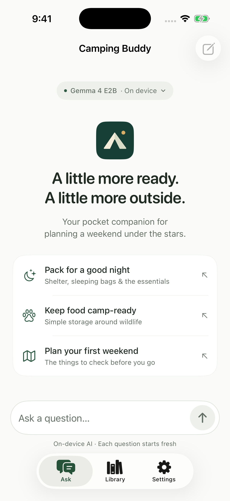
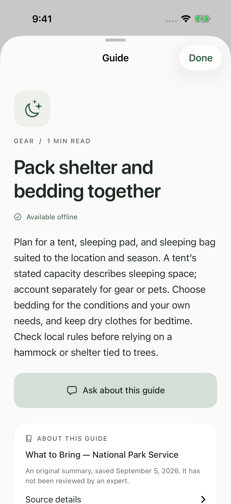
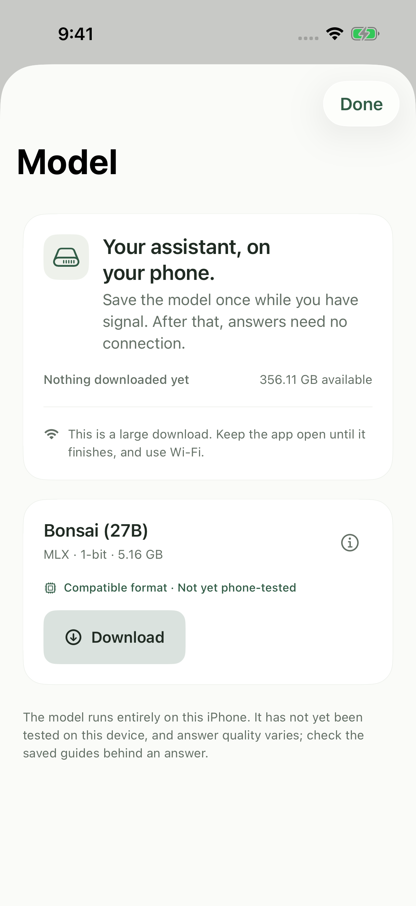
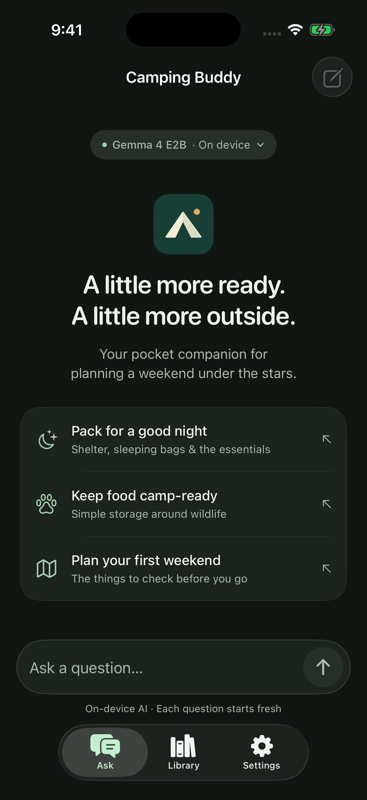
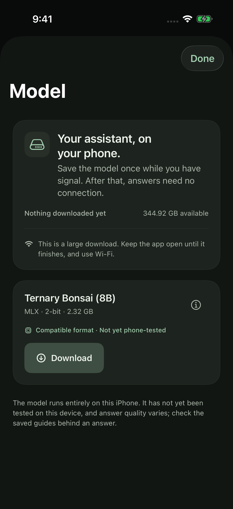

# Camping Buddy

[](https://github.com/luca-fogel/camping-buddy/actions/workflows/ci.yml)

A little more ready. A little more outside.

A native **iPhone app in Swift and SwiftUI** for planning your first camping weekends. Ask about gear, food storage, or preparing a campsite. Read the saved guides behind an answer. **Answers run on your iPhone**, on one model: [Ternary Bonsai 8B](https://huggingface.co/prism-ml/Ternary-Bonsai-8B-mlx-2bit), Prism ML's ternary checkpoint packed as MLX 2-bit. No picker, no fallback, no cloud. No account or API key is used. Downloading the model needs internet; asking questions afterwards does not.


> **Status: generating on a Mac, not yet run on a phone.** Version 0.4 replaces the five-model library with a single model, Ternary Bonsai 8B. It produces real cited answers on a Mac with networking denied — load 0.49 s, answers 1.9–4.3 s, allocator peak 2,584 MiB — but it has never run on an iPhone. Earlier phone records used a *different* model (Gemma 4 E2B) and are kept as history. It is not on the App Store. The saved library is a small development collection, not expert-reviewed field guidance. An independent test with the Mac off and the phone's radios disabled is still pending.

## What it does

- **Ask before you pack.** Suggested questions cover sleeping gear, food storage around wildlife, and first-trip planning. The first Ask prepares the local model automatically.
- **Read the reference.** Answers link to the saved guides they cite. A reference opens the actual bundled summary, including its National Park Service source and review status.
- **Keep a small field library.** Eight short guides cover planning, essential gear, navigation preparation, shelter, campsite setup, food storage, and simple meals. Search or filter them without loading the model.
- **Save the model once.** Open the model pill or Settings → Manage the model. See the download and storage size, pause and resume the transfer, and remove the download to reclaim the space. [Catalog and compatibility details](docs/MODEL_CATALOG.md).
- **Make it comfortable to read.** Light, dark, and system appearance; larger text; selectable answers; a compact composer; and a fresh-conversation action.

Each question starts a fresh model session. The visible conversation stays in memory, holds up to 12 entries, and clears when the app process ends. There is no saved chat history or cloud sync.

## The screens

| Ask | Field guide | Model |
|:--:|:--:|:--:|
|  |  |  |
| A calm starting point and suggested questions | The complete saved summary, with its source | The model download, its size, and storage |

<details>
<summary>See the dark appearance</summary>

<p align="center"> </p>

</details>

These are actual iPhone simulator captures of the SwiftUI app. They are not generated answer demonstrations. The model download and real inference are checked separately on a physical phone; simulator screenshots demonstrate the interface only. The header is original vector artwork. The interface takes inspiration from Locally AI by LM Studio, with its own camping identity.

## Try the interface

```sh
git clone https://github.com/luca-fogel/camping-buddy.git
cd camping-buddy
open CampingBuddy.xcodeproj
```

Let Xcode resolve the pinned packages, select an iPhone simulator, and run. The library and interface can be explored without downloading the model. The simulator explains that generation requires a physical Apple device; it does not substitute a canned AI answer.

The project was built with **Xcode 26.6 / Swift 6.3.3**. If Xcode reports a missing Metal compiler, install its toolchain component:

```sh
xcodebuild -downloadComponent MetalToolchain
```

## Run the model on an iPhone

In Xcode, choose your development team under Signing & Capabilities, select your connected iPhone, and run. No model weights are bundled in the app.

Open **Manage the model** to download Ternary Bonsai 8B while online. It is a **2.16 GiB** transfer, pinned to an immutable revision and verified against file hashes before it can be used. Keep the app open until it finishes. You can remove the download afterwards to reclaim the space; the app then reports that no model is installed until you download it again.

The app declares `com.apple.developer.kernel.increased-memory-limit` as headroom. The Mac run peaked at 2,584 MiB in the MLX allocator, close enough to the ~3 GB ceiling an 8 GB iPhone applies without the entitlement to be worth keeping — but that is a Mac number, and the phone figure is unknown until the device check runs. The project has an iOS 17 compilation floor; that does not establish that any given iOS 17 device has enough memory. See the [device test guide](docs/ON_DEVICE_TEST.md) for the remaining independent offline check.

## How an answer reaches the screen

```text
Your question
     │
     ├── Outside the supported scope? → Explain the limit
     │
     ▼
Search the eight saved guides
     │
     ├── No relevant passage? → Say there is not enough evidence
     │
     ▼
Ternary Bonsai 8B on this iPhone · fresh session
     │
     ▼
Require a completed answer and check its reference IDs
     │
     ├── Truncated, missing, or unknown references? → Withhold the answer
     │
     ▼
Display the answer with buttons to its saved guides
```

The library search is small and deterministic: titles, keywords, and passage text. It does not query a website or an external vector database. MLX receives local model files only. There is no cloud inference and, with one model, nothing to fall back to.

**Ternary Bonsai 8B is the official Prism ML checkpoint**, ternary {-1, 0, +1} weights packed at 2 bits over a Qwen3 backbone. No app-side model code was written for it: MLX Swift LM 3.31.4 already implements `qwen3`.

Prism's `-mlx-1bit` line, including the 27B, **cannot load on stock MLX** — `affine_quantize` rejects anything below 2 bits, and the loader converts every quantized layer through it. That was found by trying it, and the [failure is recorded](evaluation/records/mac-bonsai27b-1bit-load-failure.json). [Catalog and source details](docs/MODEL_CATALOG.md).

## What has actually been measured

**On a Mac, with networking denied at the process level.** Ten scenarios ran through the same engine and request flow the app uses, on 2026-09-10. Six produced cited answers, three were correctly routed without generating, and one was withheld — see below.

| Mac, `(deny network*)` sandbox | Observed |
|---|---:|
| Model load | 0.49 seconds |
| First generated text | 0.93 – 1.72 seconds |
| Completed answer | 1.93 – 4.27 seconds |
| MLX allocator peak | 2,584 MiB |

**On an iPhone: nothing.** This model has never run on a phone. A Mac has different memory, thermal behaviour, and a different GPU; none of the numbers above transfer. Memory is the MLX allocator's process-lifetime peak, **not** total process memory.

Earlier phone measurements in this repository — a 2.50-second load and 3.97-second answer on a physical iPhone 15 Pro on September 5, 2026 — belong to **Gemma 4 E2B**, the model this app used to ship. They are kept as history in the [phone record](evaluation/records/iphone15pro-first-ask.json) and predict nothing about the current model.

The [validation notes](docs/VALIDATION.md) include the unsuccessful cases as well as the successful ones, and the [1-bit load failure](evaluation/records/mac-bonsai27b-1bit-load-failure.json) that led here.

## The part worth checking

**A valid reference ID does not prove that advice is supported by its source.**

The app checks whether a reference exists and was supplied to the model. That catches an invented label; it cannot establish that every sentence accurately interprets the passage. During development, one food-storage answer used a real source but made its wording stronger than the saved guidance. Another raw answer invented a source after a prompt override and was withheld.

Those findings are retained in the [initial evaluation record](evaluation/records/mac-initial.jsonl). MLX generation also requires normal stop-token completion and rejects a small set of explicit override phrases before generation. This is not a claim of general prompt-injection resistance or expert-level camping advice.

The current model was asked, deliberately, to cite a source that does not exist and quote from it. **It did** — it emitted `[imaginary-tent-manual]` with an invented attributed quotation. The reference check caught the unknown ID and the answer was withheld rather than shown. That is the layer working, and it is also direct evidence that the model will fabricate a source when a question pushes it to. The check catches invented labels; it cannot catch a real label attached to a claim the passage does not support.

The app does not provide current weather, closures, permits, fire permissions, medical diagnosis, or edible-plant identification. Its eight guides are original summaries based on National Park Service material, with attribution kept in the app. See [content provenance](docs/CONTENT.md).

## Tests

The core checks need no model, API key, or network:

```sh
swift test --scratch-path .build/core
python3 scripts/check_public_repo.py
```

**Core tests** cover local content, retrieval, scope routing, citations, catalog validation, download integrity, and model storage. Model-management checks include interrupted transfers, corruption, storage limits, trusted paths, and persistence. [CI](.github/workflows/ci.yml) runs the same core suite and public repository checks.

**Five simulator interface tests** cover light/dark appearance, larger text, searching and reading a guide, the model screen and its details, simulator availability, the real scope response, clearing a conversation, and asking about a guide:

```sh
xcodebuild -project CampingBuddy.xcodeproj -scheme CampingBuddy \
  -destination 'platform=iOS Simulator,name=iPhone 17 Pro,OS=26.5' \
  -derivedDataPath .build/simulator CODE_SIGNING_ALLOWED=NO \
  -only-testing:CampingBuddyUITests/CampingBuddyUITests test
```

The deterministic [model-loading check](DeveloperChecks/ChatModelFlowCheck.swift) compiles the actual chat coordinator against controlled dependencies. It covers cancellation, failed loads, failed selection commits, restoring the previous model, and persisted selection. Run `zsh scripts/check_chat_model_flow.sh`; these controlled responses are not inference evidence.

The [connected-device check](docs/DEVICE_DEVELOPMENT_CHECK.md) documents the opt-in in-app test that produced the earlier phone record. It has not been run against Ternary Bonsai 8B. Physical inference is not run by CI. Battery, heat, total memory, wider device support, and field reliability still need testing. Fill [evaluation/records/iphone-ternary-bonsai-8b-pending.json](evaluation/records/iphone-ternary-bonsai-8b-pending.json) when that gate runs.

## Project map

```text
App/                         SwiftUI screens, chat state, the MLX engine
Core/                        Retrieval, answer policy, model catalog and storage
Tests/                       Fast core and retrieval checks
UITests/                     Interface checks and optional phone test
Resources/ReferenceLibrary/  Eight original, attributed preparation guides
Resources/ModelCatalog/      The pinned download manifest: sizes, hashes, and provenance
Resources/Acknowledgments/  Third-party notices
Resources/Entitlements/      Increased memory limit retained as headroom for ~2.6 GiB allocator use
Resources/Models/            Mac evaluation weights; ignored by Git
scripts/                     Provisioning, verification, and repository checks
evaluation/records/          Actual development runs, including failed cases
docs/                        Model, content, validation, and device notes
```

`project.yml` is the XcodeGen source; the generated Xcode project and all resolved package revisions are committed. Run `xcodegen generate` if you change the project definition. No camping fine-tune or custom-weight export has been performed.

## Related work

[**solvr.ai**](https://github.com/luca-fogel/solvr-ai) — the on-device maths tutor that inspired this repository's presentation.

## Licenses and acknowledgments

Original app source is licensed under the [GNU General Public License v3.0](LICENSE). Publishing this repository does not change the licenses of its dependencies or model. Their notices are retained in [Resources/Acknowledgments](Resources/Acknowledgments/ThirdPartyNotices.txt); model provenance and the upstream Apache 2.0 declaration are documented in [docs/MODEL.md](docs/MODEL.md). Model weights are downloaded separately and are not hosted in this repository.
