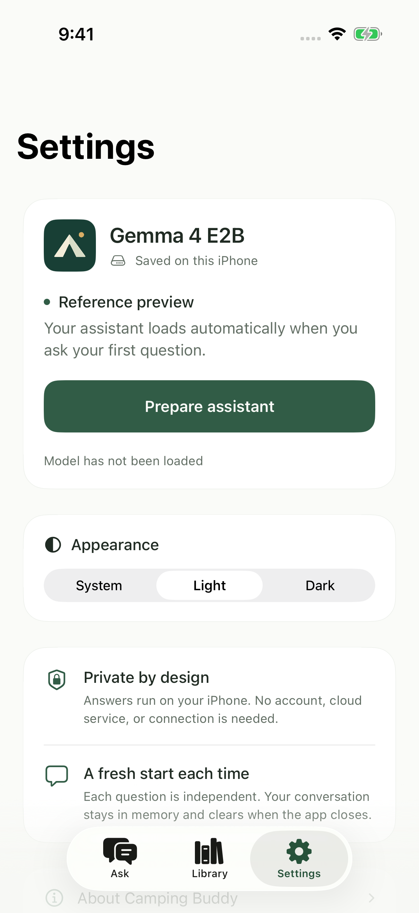

# Camping Buddy

[](https://github.com/foggylulu/camping-buddy/actions/workflows/ci.yml)

A little more ready. A little more outside.

A native **iPhone app in Swift and SwiftUI** for planning your first camping weekends. Ask about gear, food storage, or preparing a campsite. Read the saved guides behind an answer. **Gemma 4 E2B runs locally through Apple MLX**, using model files bundled with the app: no account, API key, cloud inference, or runtime download.


> **Status: running on a real iPhone, not released.** Version 0.2 has been built, installed, and tested on an iPhone 15 Pro. It is not on the App Store. The saved library is a small development collection, not expert-reviewed field guidance. An independent test with the Mac off and the phone's radios disabled is still pending.

## What it does

- **Ask before you pack.** Suggested questions cover sleeping gear, food storage around wildlife, and first-trip planning. The first Ask prepares the local model automatically.
- **Read the reference.** Answers link to the saved guides they cite. A reference opens the actual bundled summary, including its National Park Service source and review status.
- **Keep a small field library.** Eight short guides cover planning, essential gear, navigation preparation, shelter, campsite setup, food storage, and simple meals. Search or filter them without loading the model.
- **Make it comfortable to read.** Light, dark, and system appearance; larger text; selectable answers; a compact composer; and a fresh-conversation action.

Each question starts a fresh model session. The visible conversation stays in memory, holds up to 12 entries, and clears when the app process ends. There is no saved chat history or cloud sync.

## The screens

| Ask | Field guide | Settings |
|:--:|:--:|:--:|
|  |  |  |
| A calm starting point and suggested questions | The complete saved summary, with its source | Model preparation, appearance, and privacy details |

<details>
<summary>See the dark appearance</summary>

<p align="center"></p>

</details>

These are actual iPhone simulator captures of the SwiftUI app. They are not generated answer demonstrations. The Settings screenshot honestly identifies the simulator as a reference preview; real inference was checked separately on a physical phone. The header is original vector artwork. The interface takes inspiration from Locally AI by LM Studio, with its own camping identity.

## Try the interface

```sh
git clone https://github.com/foggylulu/camping-buddy.git
cd camping-buddy
open CampingBuddy.xcodeproj
```

Let Xcode resolve the pinned packages, select an iPhone simulator, and run. The library and interface can be explored without downloading the model. The simulator explains that local MLX generation requires a physical Apple device; it does not substitute a canned AI answer.

The project was built with **Xcode 26.6 / Swift 6.3.3**. If Xcode reports a missing Metal compiler, install its toolchain component:

```sh
xcodebuild -downloadComponent MetalToolchain
```

## Run the model on an iPhone

Provision the model on your Mac before building the phone app:

```sh
python3 scripts/provision_model.py
python3 scripts/verify_model.py
```

This downloads **3.58 GB** of pinned model files and checks their SHA-256 hashes. The download can resume after interruption. The weights stay outside Git; the immutable revision, file sizes, and hashes are recorded in [model-lock.json](model-lock.json).

In Xcode, choose your development team under Signing & Capabilities, select your connected iPhone, and run. Ask a question to prepare the model and get an answer. **Settings → Prepare assistant** loads it beforehand if you prefer.

The verified phone is an **iPhone 15 Pro running iOS 26.6.1**. The project has an iOS 17 compilation floor; that does not establish that every iOS 17 device has enough memory to run the model. See the [device test guide](docs/ON_DEVICE_TEST.md) for the remaining independent offline check.

## How an answer reaches the screen

```text
Your question
     │
     ├── Outside the supported scope? → Explain the limit
     │
     ▼
Search the eight saved guides
     │
     ├── No relevant passage? → Say there is not enough evidence
     │
     ▼
Gemma 4 E2B · local files · fresh session
     │
     ▼
Require a completed answer and check its reference IDs
     │
     ├── Truncated, missing, or unknown references? → Withhold the answer
     │
     ▼
Display the answer with buttons to its saved guides
```

The library search is small and deterministic: titles, keywords, and passage text. It does not query a website or an external vector database. The model loader receives a local directory and a local tokenizer. There is no cloud or Apple Foundation Models fallback.

The model is **ordinary MLX affine 4-bit Gemma 4 E2B IT**. It is distinct from Google's mobile QAT/LiteRT artifact. [Model provenance](docs/MODEL.md) records that distinction, the retained upstream license files, and the conversion card's inconsistent license metadata.

## What has actually been measured

On **September 5, 2026**, a single Ask from a fresh app session on the physical iPhone prepared the model and generated an accepted sleeping-gear answer. The check supplied only a question, then used the same request flow as the visible app.

| Physical iPhone 15 Pro | Observed |
|---|---:|
| Model preparation | 2.50 seconds |
| First generated text, internal | 1.45 seconds |
| Completed answer, after preparation | 3.97 seconds |
| Output | 77 tokens, stop-token completion |
| MLX allocator peak | 2,580 MiB |

The [actual phone record](evaluation/records/iphone15pro-first-ask.json) includes the answer and the saved passage it cited. Memory is the MLX allocator's process-lifetime peak, **not total app memory**. This was a fresh app process with the Mac connected; caches may be warm, and networking was not disabled. The record therefore leaves `offlineVerified` false.

Separate [Mac evaluation records](evaluation/records/mac-final.jsonl) were collected with networking denied to the process. They helped expose truncation, citation, and advice-quality issues. Those results are not phone performance measurements. The [validation notes](docs/VALIDATION.md) include the unsuccessful cases as well as the successful ones.

## The part worth checking

**A valid reference ID does not prove that advice is supported by its source.**

The app checks whether a reference exists and was supplied to the model. That catches an invented label; it cannot establish that every sentence accurately interprets the passage. During development, one food-storage answer used a real source but made its wording stronger than the saved guidance. Another raw answer invented a source after a prompt override and was withheld.

Those findings are retained in the [initial evaluation record](evaluation/records/mac-initial.jsonl). Current code also requires normal stop-token completion and rejects a small set of explicit override phrases before generation. This is not a claim of general prompt-injection resistance or expert-level camping advice.

The app does not provide current weather, closures, permits, fire permissions, medical diagnosis, or edible-plant identification. Its eight guides are original summaries based on National Park Service material, with attribution kept in the app. See [content provenance](docs/CONTENT.md).

## Tests

The core checks need no model, API key, or network:

```sh
swift test --scratch-path .build/core
python3 scripts/check_public_repo.py
```

**Eight core tests** cover local content, retrieval, scope routing, override handling, and unknown or unsupplied citations. [CI](.github/workflows/ci.yml) runs the same core suite and public repository checks.

**Four simulator interface tests** cover light/dark appearance, larger text, searching and reading a guide, simulator availability, the real scope response, clearing a conversation, and asking about a guide:

```sh
xcodebuild -project CampingBuddy.xcodeproj -scheme CampingBuddy \
  -destination 'platform=iOS Simulator,name=iPhone 17 Pro,OS=26.5' \
  -derivedDataPath .build/simulator CODE_SIGNING_ALLOWED=NO \
  -only-testing:CampingBuddyUITests/CampingBuddyUITests test
```

The [connected-device check](docs/DEVICE_DEVELOPMENT_CHECK.md) documents the opt-in in-app test that produced the published phone record. Physical inference is not run by CI. Battery, heat, total memory, wider device support, and field reliability still need testing.

## Project map

```text
App/                         SwiftUI screens, chat state, local MLX engine
Core/                        Reference retrieval and answer policy
Tests/                       Fast core and retrieval checks
UITests/                     Interface checks and optional phone test
Resources/ReferenceLibrary/  Eight original, attributed preparation guides
Resources/Acknowledgments/  Third-party notices
Resources/Models/            Provisioned weights; ignored by Git
scripts/                     Provisioning, verification, and repository checks
evaluation/records/          Actual development runs, including failed cases
docs/                        Model, content, validation, and device notes
```

`project.yml` is the XcodeGen source; the generated Xcode project and all resolved package revisions are committed. Run `xcodegen generate` if you change the project definition. No camping fine-tune or custom-weight export has been performed.

## Related work

[**solvr.ai**](https://github.com/foggylulu/solvr-ai) — the on-device maths tutor that inspired this repository's presentation.

## Licenses and acknowledgments

The app's original source does not yet have a redistribution license. Publishing this repository does not change the licenses of its dependencies or model. Their notices are retained in [Resources/Acknowledgments](Resources/Acknowledgments/ThirdPartyNotices.txt); model provenance and the upstream Apache 2.0 declaration are documented in [docs/MODEL.md](docs/MODEL.md). Model weights are downloaded separately and are not hosted in this repository.
